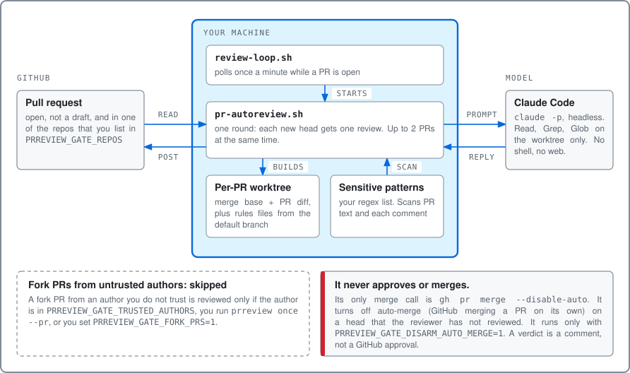
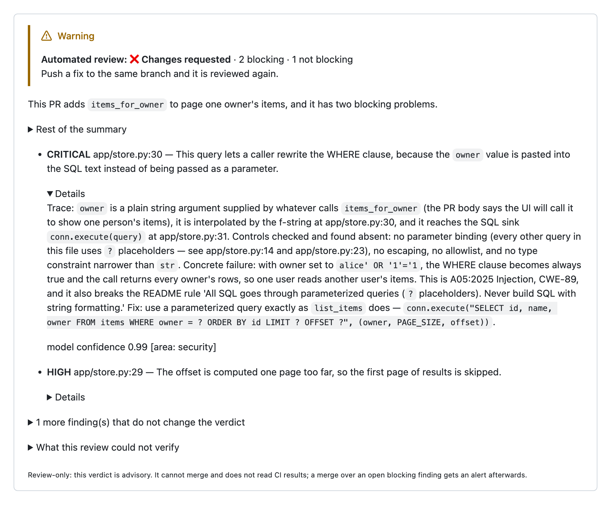
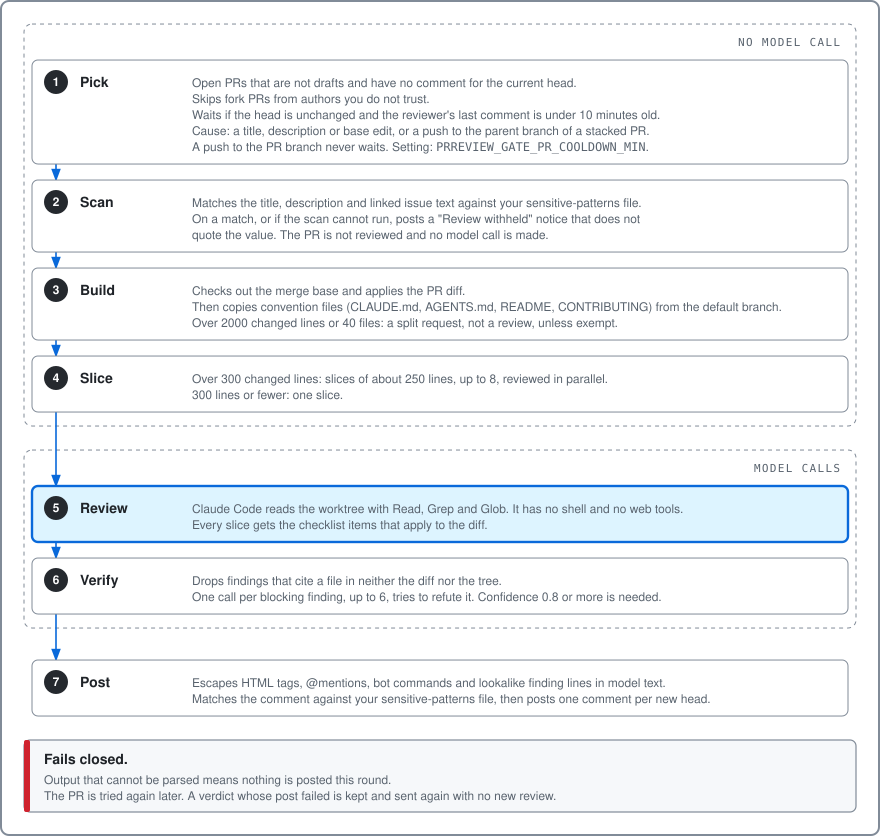
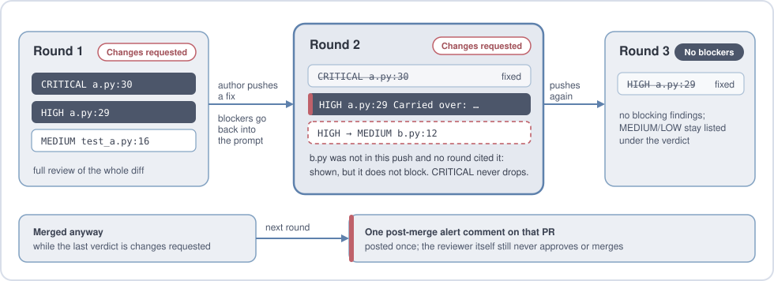

# pr-reviewer

[](https://github.com/nagameTW/pr-reviewer/actions/workflows/ci.yml)
[](./LICENSE)
[](#requirements)

**A pull-request reviewer that reads your code and comments on the PR.**

It runs on your own machine. It watches the repos you list, asks headless
[Claude Code](https://code.claude.com/docs/en/overview) to review
every new head of every open PR from a trusted author (see
[Whose PRs it reviews](#whose-prs-it-reviews)), checks what comes back, and
posts one comment with a verdict and the findings.

- **It only comments.** It never submits a GitHub approval, never requests
  changes as a formal review, and never merges. The person who holds the merge
  button decides what to do with the verdict.
- **The model can only read.** `--tools` limits Claude Code to `Read`, `Grep`
  and `Glob` in a per-PR worktree, so it has no shell and no web tools, and
  your code is never run. MCP servers and slash commands are off. This needs
  Claude Code 2.1.305 or later.
- **A PR's edits to convention files are reverted.** `CLAUDE.md`, `AGENTS.md`
  and the repo's other convention files are read as they are at the PR's
  merge base. For a PR based on another branch, each one the tree has is
  replaced with the default branch's version, or removed when the default
  branch does not have it. The match is exact in file name case, so an edit to
  a file such as `readme.md` is not reverted.
- **It tries to prove itself wrong.** Each blocking finding, up to six a
  round, gets a second call that argues against it, and a finding that call
  refutes is dropped.
- **It holds back when a step fails.** An answer it cannot parse or scan is
  not posted. A repaired answer never approves. A slice that fails forces a
  Changes requested verdict.

[Security model](#security-model) lists what it trusts and what it does not.

One real run on a test PR (Run A), with the waits cut out. Three pushes, three
rounds: round 1 finds an SQL injection and a paging bug, round 2 sees the
injection fixed and carries the paging finding over, round 3 approves. Round 1
cost $0.54 and the three rounds cost $1.14 in all. These figures were measured
on a test PR in September and October 2026, before v0.2.0 changed the default
models. Current costs can differ.

<p align="center">
  
</p>

<p align="center">
  
</p>

It is plain bash on top of `gh`, `git`, `jq` and the `claude` CLI. There is no
server and no webhook: a loop polls once a minute, and each round is one run
of `pr-autoreview.sh`. `prreview setup` walks you through the settings and, if
you say yes, installs the loop as a background service.

## Contents

- [What a review looks like](#what-a-review-looks-like)
- [What it does, and what it does not](#what-it-does-and-what-it-does-not)
- [Whose PRs it reviews](#whose-prs-it-reviews)
- [Terms](#terms)
- [What it checks](#what-it-checks)
- [Adding your own checks](#adding-your-own-checks)
- [Requirements](#requirements)
- [Quick start](#quick-start)
- [Everyday commands](#everyday-commands)
- [Upgrading](#upgrading)
- [Where it keeps its files](#where-it-keeps-its-files)
- [Removing it](#removing-it)
- [Posting as a GitHub App](#posting-as-a-github-app)
- [Windows](#windows)
- [Without prreview](#without-prreview)
- [How one round works](#how-one-round-works)
- [Across rounds](#across-rounds)
- [When something fails](#when-something-fails)
- [Configuration](#configuration)
- [Security model](#security-model)
- [Cost](#cost)
- [Development](#development)
- [License](#license)

## What a review looks like

This is the comment one round posted on a test PR (Run B). The PR added a query
function with two planted bugs: SQL built with an f-string, which the repo's
README forbids, and paging that is off by one page. The round made three model
calls and cost $0.75. This figure was measured on a test PR in September and
October 2026, before v0.2.0 changed the default models. Current costs can
differ.

<p align="center">
  
</p>

The comment leads with the verdict and one line per finding; the detail sits
in folded sections, opened here for the first finding. Every finding names a
file and line, says what goes wrong on real input, and gives the fix. A
security finding cites the standard it falls under, from the list in
`checks/`. The folded summary also checks the PR description against the
diff: "pytest passes locally" with no recorded output is called out as a claim
with no evidence.

## What it does, and what it does not

It does:

- Review every new head of every open PR in the repos you list, once, when the
  PR comes from a trusted author. A PR from a fork is skipped unless its
  author is trusted (see [Whose PRs it reviews](#whose-prs-it-reviews)). A head
  it has already commented on is skipped until the author pushes again, or
  edits the PR's title, description or base branch. For a PR based on another branch
  (a stacked PR), a push to that parent branch counts too. Each of these is a
  new review, and a new model call. Draft PRs are skipped until they are marked
  ready.
- Read the repo the way a reviewer would: the whole tree at the PR's merge base
  with the PR's diff applied, plus the conventions the repo writes down for
  itself (`CLAUDE.md` or `AGENTS.md`, then `README` and `CONTRIBUTING`, and
  `.github/review-checks.md` if the repo has one).
- Split big diffs into slices and review each one with the full checklist.
- Make one refutation call per blocking finding (up to six a round), which
  tries to prove the finding wrong, and drop the ones it refutes.
- Ask the model to repeat each unfixed finding in the next round, word for
  word. The harness does not check that it does.
- Post one alert comment if a PR is merged while the reviewer's last comment
  on it still asks for changes or withholds the review (see
  [Across rounds](#across-rounds)).

It does not:

- Approve, request changes as a formal GitHub review, merge, or push. With the
  defaults it also opens no issues and leaves auto-merge alone: it only
  comments.
- Run your tests or read your CI results. It reads code; it does not execute it.
- Give the model a shell, web tools, MCP servers or slash commands. `--tools`
  limits Claude Code to `Read`, `Grep` and `Glob`, scoped to the review clone,
  plus `Read` on the round's own copies of the diff and of the PR's title and
  description (with the title and body of the issue the PR links, when it
  links one).
- Review a PR whose title, description or linked issue matches your
  sensitive-data patterns, or post a comment that does.

## Whose PRs it reviews

The reviewer reads a PR in three cases:

- The PR comes from a branch of the repository itself, not from a fork.
- The author's login is in `PRREVIEW_GATE_TRUSTED_AUTHORS`.
- You named the PR with `prreview once --pr owner/repo#N`.

It skips every other PR. In practice, a skipped PR comes from a fork, and its
author is not on the list. Anyone can open a fork PR, and each push to it would
start a new model call on your account.

The reviewer posts nothing on a skipped PR. One exception exists. With
`PRREVIEW_GATE_DISARM_AUTO_MERGE=1`, the reviewer turns off an auto-merge that
is armed on a skipped PR. That is one `gh pr merge --disable-auto` call, and
the skipped PR gets nothing else. Only a user with write access to the
repository can arm auto-merge. The loop that starts the rounds
applies the same rule to its check, with the same two settings. A skipped PR
then does not start a round each minute, and the loop keeps its idle schedule.
The exception is `PRREVIEW_GATE_DISARM_AUTO_MERGE=1` with auto-merge armed on
the PR: the loop counts that PR as work, draft or not, so the disarm runs
within one interval. The loop does not count any other draft PR, because the
round skips it.
The scan of merged PRs does not look at the author. The round log names a
skipped PR by number and never by title. A round that skips PRs prints one `WARNING:` line with the
count, and `prreview status` shows the count for the last round.

To review one outside PR, name it:

```bash
./prreview once --pr owner/repo#12
```

The command reviews the current head of that PR and no other PR. When the
author pushes again, the new head is skipped until you run the command again.
If a round is running, the command waits for it up to `PRREVIEW_GATE_ONCE_WAIT`
seconds (300 by default). A value of `0` means do not wait. If the command
cannot get the lock in that time, it prints the reason and exits with code 75,
so you know the PR was not reviewed. It rejects
anything that is not `owner/repo#N` for a repository you review.

The exit code says if the reviewer has posted a verdict on the PR:

- `0`: the reviewer has a verdict comment on the current head, from this run
  or an earlier one. A verdict is an approve or a request for changes.
- `75`: the reviewer has no verdict on the current head, and nothing failed.
  The PR can be a draft, or a check can have skipped it. The command prints the
  reason.
- `1`: the PR is not open, or the reviewer could not read it.

A notice is not a verdict. The title format reminder and the sensitive-data
notice are notices. A check that posts a notice and stops gives `75` on the
first run, and `75` on every later run, until the title or description is
fixed and the reviewer posts a verdict. The loop still posts a notice once per
head.

To review the PRs of one fork author each time, put the login in
`PRREVIEW_GATE_TRUSTED_AUTHORS`:

```bash
./prreview set PRREVIEW_GATE_TRUSTED_AUTHORS "alice bob"
```

Write each login as `gh pr list --json author` prints it. Separate logins with
spaces or commas. Letter case does not matter. To review every PR, as the
reviewer did before this rule, set `PRREVIEW_GATE_FORK_PRS=1`.

Four limits apply:

- Do not add an account only because it contributed once. List only accounts
  that you would let push to the repository.
- The rule treats everyone who can push to the repository as trusted. If a
  workflow of yours builds branches from outside input, for example with
  `pull_request_target`, a branch of the repository can carry outside text.
- The list is a setting of the machine that runs the reviewer. When several
  maintainers each run a reviewer, each one sets the list.
- The reviewer decides on the list it reads at the start of the repository's
  round. If a PR turns into a fork PR after that read, the reviewer reads the
  PR once with `gh pr view`. The review job then checks the rule again and
  stops. That PR gets no model call and no post. With
  `PRREVIEW_GATE_DISARM_AUTO_MERGE=1`, the job also turns off its auto-merge.

## Terms

The rest of this README uses these words in one sense each.

| Term | Meaning |
| --- | --- |
| **Gate** | The name the code and its settings use for the reviewer: `pr-autoreview.sh`, the `PRREVIEW_GATE_*` settings, `gate.log`. It only comments; it does not block or merge anything, which is why its log calls the comment a review-only verdict. |
| **Head** | The latest commit on a PR's branch. The reviewer reviews heads, not branches. |
| **Trusted author** | The author of a PR that comes from a branch of the repository itself, or a login in `PRREVIEW_GATE_TRUSTED_AUTHORS`. A PR that `prreview once --pr` names is reviewed as if its author were trusted. |
| **Round** | One run of `pr-autoreview.sh`. It goes over every listed repo and reviews each PR from a trusted author whose head has no comment yet. The loop checks once a minute for open PRs that the reviewer would read (see [Whose PRs it reviews](#whose-prs-it-reviews)) and starts a round when it finds any. A fork PR that the reviewer skips does not count, unless `PRREVIEW_GATE_DISARM_AUTO_MERGE=1` and auto-merge is armed on it. A draft PR does not count, with the same exception. With none to review, the loop starts a round only on every 15th check. The loop's log counts checks, so `[round 12]` there is the 12th check, whether or not a round ran. For a single PR, "round 2" means the second verdict comment on it: a push, an edited title, description or base branch, or (for a stacked PR) a push to its parent branch leads to the next one. |
| **Slice** | Part of a large diff, reviewed by its own model call (`PRREVIEW_GATE_CHUNK_*`). |
| **Verdict** | The first line of the comment: ✅ Approved or ❌ Changes requested. It is text in a comment, not a GitHub review state. |
| **Blocking finding** | A CRITICAL or HIGH finding that counts toward ❌ Changes requested. MEDIUM and LOW are listed without changing the verdict. |
| **Refutation** | A second model call on one blocking finding that tries to prove it wrong. A refuted finding is dropped. |
| **Hold** | A wait before the reviewer tries the same head again after a failed attempt (see [When something fails](#when-something-fails)). |
| **Owner login** | The account whose comments the reviewer treats as its own earlier verdicts (`PRREVIEW_OWNER_LOGIN`, or the App). |

Settings named `PRREVIEW_GATE_*` are read by `pr-autoreview.sh`, and `PRREVIEW_LOOP_*`
by `review-loop.sh`, which starts the rounds.

## What it checks

Every slice is reviewed against the same checklist, and each finding names the
item it comes from and a severity.

<p align="center">
  
</p>

Each item is one file in `checks/`, and that file is the full wording the
model sees. Item 3 treats a host address in any RFC 1918 private range as a
real internal address, in tests too. It allows the ranges and names reserved
for documentation. If your fixtures use other ranges, edit
`checks/03-sensitive-data.md` to match.

## Adding your own checks

The checklist is the `checks/` directory, one Markdown file per item. The
reviewer reads every `.md` file in it at the start of each round.

- **Add an item:** drop a file in `checks/`. The number at the front of the
  name is the item number, so `50-migrations.md` becomes item 50. Number your
  own items 50 and up, so a built-in item a later version adds cannot take
  the same number: two files with one number stop the reviewer.
- **Remove an item:** delete its file. The other items keep their numbers.
- **Change an item:** edit its file. The text goes to the model as written.

An item that only matters for some files can say so in front matter. This one
is sent only when the PR changes a Python file:

```markdown
---
applies_to: *.py *.pyi
---
Python — a new function that opens a file, socket or subprocess closes it on
every path, including exceptions. A leak on the error path is HIGH.
```

`*` matches across directories, so `*.py` also matches `src/app/main.py`.
An item without front matter is sent on every PR.

The reviewer refuses to start when the directory is missing or empty, when a
file name has no number, when front matter has a key other than `applies_to`,
or when all the files together exceed 64 KiB. A review that quietly skipped a
check would still read as if it had applied it.

To keep your checklist outside the clone, copy `checks/` somewhere else and
point `PRREVIEW_GATE_CHECKS_DIR` at the copy. A copy does not follow updates: when
a new version rewords a built-in item, your copy keeps the old wording.
`prreview setup` lists built-in items your copy lacks and offers to add them. It
never overwrites a file you have, and skips a built-in item whose number one
of your files already uses.

Two more places add rules for a single repo:

- **The repo's own conventions.** Write them in `CLAUDE.md`, `AGENTS.md`,
  `README` or `CONTRIBUTING`. Item 4 holds every diff to them.
- **`.github/review-checks.md` in the repo.** A plain list of extra checks this
  repo wants on every PR. The model applies each one like a numbered item,
  with the same severities.

Files in the repo are read as they are at the PR's merge base, so a PR cannot
loosen a check in the same diff it is reviewed against. For a PR based on
another branch, the ones the tree has are replaced with the default branch's
versions, so the parent branch cannot loosen a check either. This holds only
when the file name matches in exact case.

A `.github/review-checks.md` can be as short as this:

```markdown
- Every new HTTP handler checks the caller's role before it reads the
  database. A handler without that check is HIGH.
- Every migration can be rolled back. A migration with no down step is HIGH.
- User-facing text in `src/ui/` goes through `t()`. A hard-coded string is
  MEDIUM.
```

Put the severity in the check when you care about it; otherwise the model
chooses one the same way it does for the built-in items.

## Requirements

- **macOS or Linux.** On Windows it runs inside WSL2; see [Windows](#windows).
- **bash 3.2 or newer.** The bash macOS ships at `/bin/bash` works.
- **[gh](https://cli.github.com/) 2.63.0 or later**, logged in. The reviewer
  reads `baseRefOid` with `gh pr view --json`, and gh 2.63.0 is the first
  release that lists it. `prreview setup` checks `gh --version`, and the
  reviewer refuses to start on an older version. With the defaults it needs to
  read the repos and comment on their pull requests; the settings that open
  issues or touch auto-merge need more (see [Security model](#security-model)).
  Comments come from this account unless you set up a GitHub App (see
  [Posting as a GitHub App](#posting-as-a-github-app)). The reviewer clones
  over the protocol `gh config get git_protocol` reports and fetches with
  `gh`'s own login. With `ssh`, the background service has to use your SSH
  key with no prompt and possibly no ssh-agent (a systemd user service gets
  none), so `prreview setup` offers to switch `gh` to `https` when you choose
  the background service. `prreview start` offers it too, when it installs the
  service and stdin is a terminal. With no terminal, it prints the command
  and goes on. It asks nothing when it starts a service that is installed.
  The switch changes `gh` for all programs, not only this one.
- **[Claude Code](https://code.claude.com/docs/en/overview) 2.1.305
  or later**, the `claude` CLI, logged in. `prreview setup` checks both, with
  `claude --version` and `claude auth status`, and the reviewer refuses to start
  on an older version: the tool limits in [Security model](#security-model)
  need it. `claude update` installs the latest version. The
  default models are `claude-opus-5-5` for reviews and `claude-sonnet-5-5` for a
  cheap output-repair call.
- `git`, `jq`, `curl`, `openssl` and `flock`.
- One timeout command (`timeout` or `gtimeout`) and one SHA-256 command
  (`sha256sum`, `gsha256sum` or `shasum`). The scripts use the first of each
  that they find on `PATH`. `prreview setup` checks every tool in this list and
  prints the install command for your system.
- **On Linux, systemd 240 or newer** for the background service. The service
  writes its log with `StandardOutput=append:`, which systemd added in 240;
  some older distributions ship an older systemd.

On macOS with Homebrew:

```bash
brew install git jq gh coreutils flock
```

Homebrew's coreutils installs `gtimeout` and `gsha256sum`. The scripts find
both, so you do not change `PATH`.

On Debian or Ubuntu:

```bash
sudo apt install git jq curl openssl util-linux coreutils
```

Install `gh` from GitHub's own package repository, following
[Installing gh on Linux](https://github.com/cli/cli/blob/trunk/docs/install_linux.md):
older Debian and Ubuntu releases do not carry it, and the ones that do carry
an old version.

### Where to run it

Run it on a machine only you use. The background service runs as your user,
with your `gh` login, your Claude Code login and, if you set one up, a GitHub
App's private key; anyone who can act as that user can post as you.

The service is started by launchd or systemd, not by your shell, so it does
not see variables your shell profile exports. Log in with `gh auth login` and
`claude auth login`: a `GH_TOKEN` or `ANTHROPIC_API_KEY` that exists only
in your shell never reaches the service, although `prreview once` in that same
terminal does see it. On a machine with no browser, such as a server you
reach over SSH, `claude auth login` prints a link to open on another device.
Claude Code also runs with no settings sources, so nothing in
`~/.claude/settings.json` (model, permissions, hooks, `env`) applies to a
review.

On Linux, a separate account for the reviewer, called `reviewer` below, is a
good way to keep it to itself. Log in to that account directly, for example
over SSH, rather than switching to it with `su` or `sudo -iu`. A switched session has no
`XDG_RUNTIME_DIR`, so `systemctl --user` cannot reach the account's service
manager and `prreview setup` cannot install the service. If switching is the only
way in:

```bash
sudo loginctl enable-linger reviewer      # once, from an admin account
export XDG_RUNTIME_DIR=/run/user/$(id -u) # in the reviewer's session
./prreview setup
```

## Quick start

> [!WARNING]
> The first run reviews every open non-draft PR in each repo you list, except
> PRs from forks whose author is not trusted (see
> [Whose PRs it reviews](#whose-prs-it-reviews)).
> Comments post as your own `gh` account unless you set up a
> [GitHub App](#posting-as-a-github-app). Each push, each edit of a PR's
> title, description or base branch, and each push to the parent branch of a
> stacked PR, starts a new round that costs model usage. To try it first, list
> one repo that you own.

### 1. Get the code

```bash
git clone https://github.com/nagameTW/pr-reviewer.git ~/pr-reviewer
cd ~/pr-reviewer
```

On macOS, keep the clone out of `~/Documents`, `~/Desktop`, `~/Downloads` and
iCloud Drive (`~/Library/Mobile Documents`).
macOS does not let a background service read those folders. From there,
`prreview setup` stops at the start, or, if you choose, sets up for running only
in a terminal (`prreview run`, `prreview once`) with no background service.

### 2. Run the setup

```bash
./prreview setup
```

It asks one question at a time, and pressing Enter keeps the value in
brackets:

1. **Tools.** Checks that everything above is installed.
2. **Claude Code.** Checks that `claude` is logged in (`claude auth status`),
   and stops if it is not.
3. **GitHub.** Checks `gh` is logged in, and offers to run `gh auth login`.
4. **Repositories.** Lists up to 30 repositories of your own account; pick by
   number, or type `owner/repo` for any other, such as an organization's.
5. **Who posts.** Your `gh` account, or a GitHub App (see
   [Posting as a GitHub App](#posting-as-a-github-app)).
6. **PRs at the same time.** How many PRs one round reviews in parallel
   (default 2). More is faster and uses your Claude quota faster.
7. **Model.** Enter keeps the default.
8. **Sensitive-data patterns.** Writes a starter file from
   `sensitive-patterns.example`. Add what is secret where you work: internal
   hostnames, private address ranges, customer names. The reviewer checks
   every comment that carries PR text or model output against it before
   posting.
9. **Checklist.** Offers to copy `checks/` to
   `~/.config/pr-reviewer/checks`, so you can add and remove items
   without touching the clone.
10. **Background service.** Asks whether to install a launchd agent on macOS or
    a systemd user service on Linux. The answer defaults to `n` while no
    service is installed, and to `y` once one is. On `y`, the service starts
    at once and reviews the open PRs of your repositories. If `gh` clones
    over `ssh`, setup first offers to switch it to `https` (see
    [Requirements](#requirements)). On `n`, setup does not ask about `gh`
    and does not change it. An installed service starts again at every login,
    checks for new PRs every minute, and restarts if it stops. On Linux,
    systemd stops a user service when you log out and does not start it at
    boot; run `sudo loginctl enable-linger "$USER"` once to keep it running.

The answers go to `~/.config/pr-reviewer/config`, one `KEY=value` per
line. A value is taken literally: no quotes, nothing expanded. Run
`./prreview setup` again to change them, or use the commands below.

### 3. Check that it works

Once installed, the service looks for open PRs right away and reviews any it
finds from a trusted author. With no such PR open, it runs a round only every
15 minutes (`PRREVIEW_LOOP_IDLE_EVERY`), to catch PRs merged in the meantime. An
open fork PR that the reviewer skips does not start a round, and an open draft PR does not either. The exception is
`PRREVIEW_GATE_DISARM_AUTO_MERGE=1` with auto-merge armed on the PR. If you answered `n`
at the service step, nothing reviews until you run `./prreview start`,
`./prreview run` or `./prreview once`.

```bash
./prreview status    # the main settings, service state, skipped PRs, the last log lines
./prreview logs -f   # follow the background service
./prreview once      # run one round in this terminal
```

With no open PR, a round has nothing to review, and `./prreview once` prints only
its `ROUND USAGE: 0 call(s)` line. That is not an error. To see a review,
open a small PR in one of your repositories and watch `./prreview logs -f`: the
next check, within a minute, starts a round for it.

`prreview logs` shows the service's own log, a few lines per round. Each round's
full output is in `~/.cache/pr-reviewer/gate-logs/round-*.log`.

A round that reviews one PR prints something like this. This is a sample log.
Its cost was measured on a test PR in September and October 2026, before v0.2.0
changed the default models. Current costs can differ.

```text
[your-name__your-repo#3] PR #3: refutation upheld CRITICAL app/store.py:30 (refuted=false, confidence 0.97)
[your-name__your-repo#3] PR #3: refutation upheld HIGH app/store.py:29 (refuted=false, confidence 0.95)
[your-name__your-repo#3] https://github.com/your-name/your-repo/pull/3#issuecomment-…
[your-name__your-repo#3] PR #3: review-only verdict comment posted (verdict=request_changes)
ROUND USAGE: 3 call(s)  in=28 out=6978 cache_read=347346 cache_write=40101  cost=$0.75
  review       1 call(s)  $0.44
  verify       2 call(s)  $0.31
```

Run it again without pushing anything and the PR is skipped: the head already
has its comment. For the same reason, with the service installed,
`./prreview once` right after setup usually prints
`this head was already handled` for every PR, because the service got there
first. If it prints `another pr-autoreview run holds … — exiting`, the service
is in the middle of a round. `./prreview logs -f` shows that round, or run
`./prreview stop` first to try `once` on its own and `./prreview start`
afterwards; a stopped service stays stopped.

## Everyday commands

| Command | What it does |
| --- | --- |
| `prreview repos add owner/repo` | Review another repository |
| `prreview repos remove owner/repo` | Stop reviewing one |
| `prreview set parallel 3` | Review three PRs at the same time |
| `prreview set model <model>` | Use another model |
| `prreview set PRREVIEW_GATE_REDTEAM 1` | Any setting from [Configuration](#configuration) |
| `prreview unset parallel` | Back to the default |
| `prreview get parallel` | Print a setting, or the default when it is not set |
| `prreview checks` | List the review items |
| `prreview checks add 50-migrations` | Write a new item and open it in `$EDITOR`; needs the copy of the checklist from setup step 9. An item left as the template is not added |
| `prreview checks remove 50` | Delete an item from your copy |
| `prreview once`, `prreview run` | One round, or the loop, in this terminal instead of the background service |
| `prreview once --pr owner/repo#12` | Review that one PR now, a fork PR included (see [Whose PRs it reviews](#whose-prs-it-reviews)) |
| `prreview stop`, `prreview start`, `prreview restart` | Control the background service; after `prreview stop` it stays off across reboots and logins until `prreview start` |
| `prreview uninstall` | Remove the background service; settings stay (see [Removing it](#removing-it)) |

The commands in this table restart the service when they change a setting,
so the change takes effect. `prreview setup` does the same when the service is
already running. A change to the checklist applies from the next round
without a restart.

To type `prreview` instead of `./prreview`, link it into a directory on your `PATH`.
`~/.local/bin` is a common one, but a fresh macOS does not have it or put it
on `PATH`:

```bash
mkdir -p ~/.local/bin
ln -s ~/pr-reviewer/prreview ~/.local/bin/prreview
echo 'export PATH="$HOME/.local/bin:$PATH"' >> ~/.zshrc   # if it is not on PATH yet
```

## Upgrading

```bash
cd ~/pr-reviewer
git pull --ff-only
./prreview setup
```

After `git pull --ff-only`, run `./prreview setup` again. Claude Code 2.1.305
or later and gh 2.63.0 or later are required. Setup stops at the Claude Code
step when `claude --version` is older, and at the GitHub step when
`gh --version` is older. Run `claude update` or update gh, then run
`./prreview setup` again.

Press Enter through the questions to keep your answers, except at the
Checklist step: when setup lists built-in items your copy lacks, answer `y`
to take the new ones, since Enter declines. Setup then restarts the
background service. The restart matters: each round runs the new `pr-autoreview.sh`,
but the loop that starts the rounds keeps running the old code until it
restarts. `./prreview restart` does only that step.

After this upgrade, the reviewer skips PRs from forks unless the author is in
`PRREVIEW_GATE_TRUSTED_AUTHORS`. A PR it already reviewed keeps its comment.
`./prreview status` shows how many PRs the last round skipped, and
`PRREVIEW_GATE_FORK_PRS=1` brings back the old behavior.

Items your copy of the checklist already has keep their old wording. To see
what a new version changed in them:

```bash
diff -r ~/pr-reviewer/checks ~/.config/pr-reviewer/checks
```

## Where it keeps its files

| Path | What is there |
| --- | --- |
| `~/.config/pr-reviewer/` | `config`, `sensitive-patterns`, your copy of the checklist in `checks/`, and a GitHub App's key as `app.pem` |
| `~/.cache/pr-reviewer/` | The service's log `gate.log`, round logs in `gate-logs/`, holds in `review-holdoff/`, and the round lock |
| `~/.cache/pr-reviewer/work/` | Review clones and each round's scratch files (`PRREVIEW_GATE_WORKROOT`); under `$XDG_CACHE_HOME` when that is set |
| `~/.local/state/pr-reviewer/` | Which repo the next round starts with; under `$XDG_STATE_HOME` when that is set |
| `~/Library/LaunchAgents/local.pr-reviewer.plist` | The background service on macOS |
| `~/.config/systemd/user/pr-reviewer.service` | The background service on Linux |

## Removing it

`prreview uninstall` removes only the background service. To remove everything:

```bash
cd ~/pr-reviewer
./prreview uninstall
rm -rf ~/.config/pr-reviewer ~/.cache/pr-reviewer ~/.local/state/pr-reviewer
rm -f ~/.local/bin/prreview
cd ~ && rm -rf ~/pr-reviewer
```

The first `rm` also deletes your checklist copy and the App's key; keep
anything you want first. If `XDG_CACHE_HOME` or `XDG_STATE_HOME` is set, or
you set `PRREVIEW_GATE_WORKROOT`, remove those directories too. If you ran
`loginctl enable-linger` only for the reviewer, `sudo loginctl disable-linger
"$USER"` undoes it. A GitHub App stays on GitHub until you delete it on its
settings page. If you added a `PATH` line to `~/.zshrc` for `~/.local/bin`,
remove it by hand when nothing else uses that directory.

## Posting as a GitHub App

By default the comments come from the account `gh` is logged in as. With a
GitHub App they come from `<app-name>[bot]` instead, so they are easy to tell
apart from people's comments. The token used for posting then carries only
the App's permissions, not your account's.

`prreview setup` walks through it at the "Who posts" step:

1. It prints a link that opens GitHub's "Register new GitHub App" page with
   the fields filled in: no webhook, private, and these repository
   permissions:
   - **Pull requests: read and write**, to read PRs and post the review.
   - **Issues: read and write**. A comment on a PR is an issue comment in
     GitHub's API, and `PRREVIEW_GATE_TICKETS=1` opens issues.
   - **Metadata: read**, which GitHub adds to every App.

   For an organization's App, take that same link and change only its start,
   `https://github.com/settings/apps/new`, to
   `https://github.com/organizations/<org>/settings/apps/new`. Keep everything
   after the `?`: it sets the permissions and turns the webhook off. A bare
   URL opens an App with no permissions, and the first comment then fails.
2. On the App's page, note the **App ID**, click **Generate a private key**,
   and install the App (**Install App**) on every account or organization
   that owns a repository you review. GitHub lets a private App be installed
   only on the account that owns it. If your repositories belong to more than
   one account or organization, make the App public under **Advanced** on its
   settings page first. That lets other accounts install it; each
   installation still sees only the repositories it is given.
3. Give `prreview setup` the App ID and the downloaded `.pem` file. It copies the
   key to `~/.config/pr-reviewer/app.pem`, readable only by you, and
   checks that the App can see every listed repository. One it cannot see
   is named, with the link to install the App there or add the repository
   to it (an App installed on "Only select repositories" sees only those).

Only posting goes through the App: comments, and the follow-up issues
`PRREVIEW_GATE_TICKETS=1` opens. Reading PRs, cloning, the loop's alert issues and
`PRREVIEW_GATE_DISARM_AUTO_MERGE` still use `gh`, so `gh` still needs to be logged
in. To go back to your own account, run `prreview setup` and pick 1 at "Who posts".

Switching from your account to an App changes whose comments count as the
reviewer's own: the next round finds no comment from the App on any open PR
and reviews every one of them again. Switching back does the same for the
heads where the App left one comment: the reviewer logs a warning for each of
them, then reviews it once with your account. The reviewer also counts, on
your machine, the verdicts it posted for each head. A head for which the
machine posted two verdicts counts as handled, and the reviewer logs a warning
for it every round. It reviews the head again after the author pushes. After a
switch back, such a head stays stopped until then, even though your account
has not commented on it yet.

## Windows

The reviewer runs inside WSL2, the Linux environment built into Windows. The
steps below follow Microsoft's WSL documentation. They have not been run end
to end on Windows yet; if something differs, please open an issue.

1. **Install WSL2 with Ubuntu.** In PowerShell: `wsl --install -d Ubuntu`.
   Run `wsl --version`; 2.6 or newer is recommended (`wsl --update`). The
   distribution has to run under WSL 2, since WSL 1 has no systemd:
   `wsl -l -v` shows its version, and `wsl --set-version Ubuntu 2` converts
   it.
2. **Turn on systemd in Ubuntu**, so the reviewer can run as a service. New
   Ubuntu installs have it already. Otherwise add this to `/etc/wsl.conf`:

   ```ini
   [boot]
   systemd=true
   ```

   Then run `wsl --shutdown` in PowerShell and open Ubuntu again. Inside
   Ubuntu, also run:

   ```bash
   sudo apt install dbus-user-session
   sudo loginctl enable-linger "$USER"
   ```

3. **Follow the Linux steps inside Ubuntu:** install the tools, clone into
   your Linux home directory (`~`, not `/mnt/c`), and run `./prreview setup`.
   Answer `y` at the background service step, or run `./prreview start`
   after setup. Step 4 keeps that service running, so it needs one.
4. **Keep WSL running.** WSL shuts Ubuntu down about 15 seconds after the last
   Windows program using it closes, and a running service does not count.
   Two changes keep the reviewer alive while you are logged in to Windows:
   - In `%UserProfile%\.wslconfig` on the Windows side (WSL 2.5.7 or newer),
     then `wsl --shutdown`:

     ```ini
     [general]
     instanceIdleTimeout=-1
     ```

   - Start Ubuntu once at every Windows login, so the service starts with it.
     In PowerShell:

     ```powershell
     $a = New-ScheduledTaskAction -Execute 'wsl.exe' -Argument '-d Ubuntu --exec /bin/true'
     $t = New-ScheduledTaskTrigger -AtLogOn -User $env:USERNAME
     Register-ScheduledTask -TaskName 'pr-reviewer' -Action $a -Trigger $t
     ```

     A console window may flash briefly at login.

The reviewer stops when you log out of Windows and pauses while the PC
sleeps. It picks up again at the next login or wake-up.

## Without prreview

`prreview` only writes settings and starts the loop. Everything also works from
environment variables. The reviewer refuses to start without a
sensitive-data patterns file, so copy the example first:

```bash
mkdir -p ~/.config/pr-reviewer ~/.cache/pr-reviewer
cp sensitive-patterns.example ~/.config/pr-reviewer/sensitive-patterns
export PRREVIEW_GATE_REPOS="your-name/your-repo"
bash pr-autoreview.sh                          # one round
nohup bash review-loop.sh >> ~/.cache/pr-reviewer/gate.log 2>&1 &   # the loop
```

Each round's full output goes to `~/.cache/pr-reviewer/gate-logs/`. The
loop's own output grows without limit here: only the service `prreview` installs
keeps `gate.log` under 10 MB. Any scheduler that runs `pr-autoreview.sh`
works in place of the loop, and a lock stops two rounds from overlapping.

## How one round works

<p align="center">
  
</p>

1. **Pick.** For each repo, list the open PRs with their authors in one call.
   Keep the PRs from a trusted author that are not drafts and whose current
   head has no comment from this reviewer yet. The job checks the author
   again, with its own read of the PR, before any model call. The comment
   carries a hidden marker with the head SHA and a hash of the title,
   description and base branch (for a stacked PR, also the base commit), and
   only comments by the reviewer's own account count. A comment from another
   App that carries the marker gets a `WARNING` line in the log, and the head
   is reviewed anyway, however many such comments there are. The reviewer also
   keeps a count of the verdicts it posted for the head, in the hold directory
   (`PRREVIEW_GATE_HOLDOFF_DIR`). At two, the list of App logins is probably
   wrong (`PRREVIEW_REVIEW_APP_SLUG`) and the reviewer does not see its own
   comments. The head then counts as handled: no review, no model call, and a
   `WARNING` line in the log every round. The count file stays while its PR is
   open and expires two days after the PR closes, like the hold files. If the
   hold directory cannot be written, the reviewer skips the PR before any model
   call and the round fails, so the failure alert runs. A PR on hold after a
   failure waits out its hold (see [When something fails](#when-something-fails)).
2. **Scan.** Check the PR's title and description against your
   sensitive-patterns file. A hit stops the review of that PR. The title and
   body of the issue the PR links get the same check when the round reads
   them, before any model call.
3. **Build.** Update the local clone of the repo, add a per-PR worktree, check
   out the merge base of the PR in it, and apply the PR's diff on top. The
   author's branch is never checked out, and the convention files are restored
   from the merge base, matched by exact file name case. For a PR based on
   another branch, each one the tree has is replaced with the default branch's
   version, or removed when the default branch does not have it. A file that
   only the default branch has is not added. If a step of the replacement
   fails, the round skips that PR and tries again next round.
   The diff is fetched once, for the exact head commit the verdict will name,
   and the list of changed files is read from that same diff. A push that
   lands during the round cannot swap in another head. If the merge base
   cannot be found, if the diff cannot be fetched, or if it holds a different
   number of files than GitHub reports for the PR, the round skips that PR and
   tries again next round.
   A symlink to a regular file inside the clone, such as
   `AGENTS.md -> CLAUDE.md`, is fine. Any other symlink stops the review: one
   that points outside the clone, into `.git` or nowhere; one to a folder,
   since a path through a folder link can climb out with `..`; and one from a
   convention file (`CLAUDE.md`, `AGENTS.md`, anything under `.claude/`, a
   README or CONTRIBUTING file, `.github/review-checks.md`) to anything but
   another convention file the base branch already has under exactly that
   name, since the PR could
   edit that file and so write the rules it is judged by. The model's
   read access is limited by path, and a link can lead it past that limit. A
   symlink the PR adds gets a comment asking the author to fix or remove it. One already on the
   base branch stops every PR against that branch with no comment: the round
   log names the link, and the round counts as failed (see
   [When something fails](#when-something-fails)).
4. **Slice.** A diff of more than 300 lines is cut by file into slices of about
   250 lines, at most 8. A PR over 2000 changed lines or 40 files gets a
   "please split" comment instead of a review, unless at least 90% of its
   changed lines are deletions, it touches only lock files, generated code,
   snapshots or migrations, or its description has a paragraph starting with
   `split-exempt:` that says why it cannot be split. Those are reviewed in
   full, with two passes over each slice in the first round.
5. **Review.** Claude Code reads the tree and the diff and answers with JSON:
   a verdict, findings with severity, file, line and fix, and what it could not
   verify. The slices run in parallel.
6. **Verify.** Findings that do not have the expected shape, or cite a file
   that does not exist, are dropped. Each blocking finding then gets its own
   call that tries to refute it, up to `PRREVIEW_GATE_VERIFY_MAX` (6) a round; a
   refuted finding is dropped, and any beyond the cap stand.
7. **Post.** Render one comment, scan it against your patterns, and post it.
   Each round's model usage and cost is printed at the end.

CRITICAL and HIGH findings block; MEDIUM and LOW are listed under the verdict
without blocking. Two kinds of HIGH are listed without blocking:

- On a PR of 300 changed lines or more (`PRREVIEW_GATE_COACH_MAX_LINES`), a HIGH
  about tests, conventions, wording or process, or about a doc or code comment
  that only maintainers read. It is still shown as HIGH, marked not blocking.
  On a smaller PR it blocks like any other HIGH, and the prompt tells the
  model which of the two applies.
- On any PR, a HIGH the model tags as wording, judgment or a half-finished
  fix. It is shown as MEDIUM with its original severity next to it.

"Block" here only decides the verdict: the reviewer itself never stops a
merge.

### Optional: a red team before an approval

<p align="center">
  
</p>

The refutation calls in step 6 can only remove findings. The red team is the
one step that looks for a defect the review missed, and it runs only on a
round that is about to post ✅ Approved.

It is off by default because it adds cost and time to every approval. In
Run C, a small clean PR in the test repo, the review cost $0.34 and the
red-team call $0.23. These figures were measured on a test PR in September and
October 2026, before v0.2.0 changed the default models. Current costs can
differ. Each candidate it raises adds one refutation call, so at most three
more. The red-team call runs after the review, and the refutation calls run
together after it, so an approval can take up to twice
`PRREVIEW_GATE_VERIFY_TIMEOUT` (1200 seconds) longer to appear.

## Across rounds

<p align="center">
  
</p>

Every push is a new round, and the previous round's blocking findings go back
into the prompt. The prompt asks the model to say which ones are fixed, and to
repeat each one that is not, word for word, with a `Carried over:` prefix. The
aim is that the author sees the same finding, not a rewording of it. The
harness does not check that the model does this.

From round 2 on, a new blocking finding about a file that the changes since
the last reviewed round did not touch and that no earlier round cited is
shown as MEDIUM. It was just as visible in round 1, and the author should
not pay a round for the reviewer missing it. CRITICAL findings are never
lowered.

If a PR is merged while the reviewer's last comment on it is ❌ Changes
requested, ❌ Please split, ⛔ Review withheld or ⛔ Refused, the next round
posts one alert comment on the merged PR. With `PRREVIEW_GATE_TICKETS=1` it also
opens a follow-up issue. The check reads the first 10 merged PRs that
`gh pr list` returns, which sorts them by when they were opened, and alerts on
those merged in the last 48 hours. A PR opened long before it was merged can
fall outside those 10.

## When something fails

The reviewer does not post a verdict it could not reach. What happens instead:

- **Some slices of a large diff fail.** The slices that worked are posted as
  one comment. It always says ❌ Changes requested, whatever they found, and
  lists the files no slice reviewed; push again to review the whole diff.
- **The review fails outright**: every call fails or times out, or the answer
  still cannot be parsed after the repair call. Nothing is posted for that
  head, and the head goes on hold: 5 minutes (`PRREVIEW_GATE_HOLDOFF_FAIL`), or 30 minutes after
  a usage-limit error (`PRREVIEW_GATE_HOLDOFF_QUOTA`). Each repeat of the same
  reason doubles the wait, up to an hour (`PRREVIEW_GATE_HOLDOFF_MAX`). The round
  log says when the next attempt is due. To retry at once, delete the files
  named `<repo>-<PR number>-*` in
  `~/.cache/pr-reviewer/review-holdoff/`. A new push, or an
  edited title, description or base branch, or a push to the parent branch of a
  stacked PR, starts over with no hold.
- **Posting the comment fails.** The finished comment is kept, and the head
  goes on the same hold as above (5 minutes, doubling on repeats). The next
  attempt after that posts the kept comment without calling the model again.
- **The comment matches your sensitive-data patterns**, or the scan cannot
  run. A short notice is posted instead, and the full text goes only to the
  round log, in a directory only you can read.
- **Something stops a PR or a whole repo from being reviewed at all**: a repo
  or a PR that cannot be read, a merge base that cannot be found, a diff that
  cannot be fetched whole, a symlink on the base branch, an App token that
  cannot be created, a review job that crashes. The round finishes the other
  PRs and then exits with an error. `review-loop.sh` then opens one issue in
  `PRREVIEW_ALERT_REPO` if you set it; it opens no second one while that issue is
  open, and closing it re-arms the alert. While it stays open and rounds keep
  failing, it gets a "Still failing" comment at most every 6 hours
  (`PRREVIEW_ALERT_REPEAT_HOURS`). Without `PRREVIEW_ALERT_REPO`, the failure is only in
  the log.
- **A round runs longer than `PRREVIEW_LOOP_ROUND_TIMEOUT`** (3900 seconds). The
  loop kills it and counts it as failed. The default leaves room for a first
  round on a diff near the 2000-line ceiling: two passes over eight slices is
  16 calls, which at 8 calls in flight is two waves of
  `PRREVIEW_GATE_REVIEW_TIMEOUT`.

## Configuration

Everything is an environment variable. Two things are required:
`PRREVIEW_GATE_REPOS`, and the sensitive-data patterns file, which `prreview setup`
writes for you.
`prreview set <name> <value>` writes any of them to
`~/.config/pr-reviewer/config`, which `prreview` reads before it starts the
reviewer; a variable already set in the environment wins over the file.
`PATH` is the exception: `prreview setup` records the terminal's `PATH` so the
background service finds `gh` and `claude`, and that recorded value is used
even when you run `prreview once` from a terminal. After moving a tool, run
`prreview set PATH "$PATH"` or `prreview setup` again.

| Variable | Default | What it does |
| --- | --- | --- |
| `PRREVIEW_GATE_REPOS` | none (required) | Space-separated `owner/repo` list to review |
| `PRREVIEW_GATE_TRUSTED_AUTHORS` | empty | Logins whose fork PRs are reviewed, separated by spaces or commas (see [Whose PRs it reviews](#whose-prs-it-reviews)) |
| `PRREVIEW_GATE_FORK_PRS` | `0` | `1` reviews PRs from forks like any other PR |
| `PRREVIEW_GATE_ONCE_WAIT` | `300` | Seconds that `prreview once --pr` waits for a running round. A whole number; `0` means do not wait |
| `PRREVIEW_OWNER_LOGIN` | `gh api user` | The account whose marked comments count as this reviewer's own; with a GitHub App set, only the App's comments count |
| `PRREVIEW_REVIEW_APP_ID` | empty | A GitHub App's ID; when set, comments are posted as the App (see [Posting as a GitHub App](#posting-as-a-github-app)) |
| `PRREVIEW_REVIEW_APP_KEY` | empty | The App's private key file |
| `PRREVIEW_REVIEW_APP_SLUG` | read from GitHub every round | The App's URL name; its comments are authored by `<slug>[bot]`. Leave it unset, so renaming the App cannot leave a stale one |
| `PRREVIEW_SENSITIVE_PATTERNS_FILE` | `~/.config/pr-reviewer/sensitive-patterns` | The regex list that every comment carrying PR text or model output, and every PR title and description and every linked issue, is checked against |
| `PRREVIEW_GATE_REPO_CONTEXT` | a sentence pointing at `CLAUDE.md`/`AGENTS.md`, `README`, `CONTRIBUTING` | Replaces the sentence that tells the model where a repo's conventions live |
| `PRREVIEW_REVIEW_MODEL` | `claude-opus-5-5` | Model for the review, the refutation pass and the red team |
| `PRREVIEW_GATE_CHEAP_MODEL` | `claude-sonnet-5-5` | Model for repairing unparseable output |
| `PRREVIEW_GATE_SAMPLES` | `1` | Review passes per slice after a PR's first round; findings are merged across passes |
| `PRREVIEW_GATE_SAMPLES_ROUND1` | `1` | Review passes per slice in a PR's first round |
| `PRREVIEW_GATE_ZERO_RECHECK_LINES` | `1000` | From this many changed lines, a first round gets at least two passes; `0` turns it off |
| `PRREVIEW_GATE_REVIEW_TIMEOUT` | `900` | Seconds per review call |
| `PRREVIEW_GATE_REPAIR_TIMEOUT` | `300` | Seconds for the call that repairs an unparseable answer |
| `PRREVIEW_GATE_VERIFY_MAX` | `6` | Most blocking findings that get a refutation call |
| `PRREVIEW_GATE_VERIFY_TIMEOUT` | `600` | Seconds per refutation call |
| `PRREVIEW_GATE_CHUNK_MIN_LINES` | `300` | Diffs larger than this are sliced |
| `PRREVIEW_GATE_CHUNK_TARGET_LINES` | `250` | Target lines per slice |
| `PRREVIEW_GATE_CHUNK_MAX` | `8` | Most slices per PR |
| `PRREVIEW_GATE_MAX_REVIEW_LINES` | `2000` | Above this many changed lines, ask for a split instead of reviewing |
| `PRREVIEW_GATE_MAX_REVIEW_FILES` | `40` | The same ceiling in files |
| `PRREVIEW_GATE_SPLIT_EXEMPT_RE` | lock files, `*.gen.ts`, `*.gen.js`, `*.gen.py`, `*.gen.go`, `*.snap`, `migrations/`, `generated/`, `__generated__/`, `dist/`, `build/`, `vendor/` | Extended regex for paths that count as generated: a PR over the ceiling whose every file matches is reviewed instead of asked to split |
| `PRREVIEW_GATE_FILE_CAP` | `7` | Most findings shown for one file, counted separately for blocking and not blocking; the rest fold into one line that still counts toward the verdict. `0` shows all |
| `PRREVIEW_GATE_COACH_MAX_LINES` | `300` | From this many changed lines, a HIGH about tests, conventions, wording or process no longer blocks (see [How one round works](#how-one-round-works)) |
| `PRREVIEW_GATE_HOLDOFF_FAIL` | `300` | Seconds a head waits after a failed review or post (see [When something fails](#when-something-fails)) |
| `PRREVIEW_GATE_HOLDOFF_QUOTA` | `1800` | Seconds a head waits after a usage-limit error |
| `PRREVIEW_GATE_HOLDOFF_MAX` | `3600` | Longest wait after repeated failures |
| `PRREVIEW_GATE_HOLDOFF_DIR` | `~/.cache/pr-reviewer/review-holdoff` | Where those holds are kept, along with verdicts waiting to be posted again and the count of verdicts posted for each head |
| `PRREVIEW_GATE_PARALLEL` | `2` | PRs reviewed at the same time |
| `PRREVIEW_GATE_CALL_CAP` | `8` | Model calls in flight for one PR |
| `PRREVIEW_GATE_ROUND_BUDGET` | `900` | Seconds a round may spend starting new reviews |
| `PRREVIEW_GATE_REDTEAM` | `0` | `1` adds a red-team call on PRs about to be approved (see [the red team](#optional-a-red-team-before-an-approval)) |
| `PRREVIEW_GATE_REDTEAM_MAX` | `3` | Most red-team candidates that get a refutation call |
| `PRREVIEW_GATE_REDTEAM_SPEC_MAX` | `80` | Most document paths (docs, specs, ADRs, schemas) the red team is shown |
| `PRREVIEW_GATE_SYMBOLS` | `1` | Lists, for each definition the diff changes, the references it left untouched, and gives the list to the model; no model cost. `0` turns it off |
| `PRREVIEW_GATE_VERIFY_LINES` | `0` | `1` drops a finding whose line number is past the end of the file it cites |
| `PRREVIEW_GATE_WORKROOT` | `~/.cache/pr-reviewer/work` | Where the review clones and scratch files live; must be absolute |
| `PRREVIEW_GATE_LOCK` | `~/.cache/pr-reviewer/pr-autoreview.lock` | The lock that keeps two rounds from running at once |
| `PRREVIEW_STATE_DIR` | `$XDG_STATE_HOME`, else `~/.local/state` | Where state that must outlive a cleared cache goes, under `pr-reviewer/` |
| `PRREVIEW_GATE_CURSOR` | `pr-reviewer/gate-repo-cursor` in that directory | The file that records which repo the next round starts with |
| `PRREVIEW_GATE_CHECKS_DIR` | `checks/` next to the script | The checklist directory, one file per item (see [Adding your own checks](#adding-your-own-checks)) |
| `PRREVIEW_GATE_TITLE_CHECK` | `0` | `1` asks for Conventional Commits PR titles and skips PRs without one |
| `PRREVIEW_GATE_ISSUE_NOTE` | `0` | `1` adds a note when a PR links no issue |
| `PRREVIEW_GATE_TICKETS` | `0` | `1` opens follow-up issues for some findings that do not block (see [Follow-up issues](#follow-up-issues)); the token then needs to open issues |
| `PRREVIEW_GATE_ISSUE_MIN_SEVERITY` | `high` | Which of those findings get an issue: `critical`, `high`, `medium` or `low` |
| `PRREVIEW_GATE_DISARM_AUTO_MERGE` | `0` | `1` turns off an auto-merge that was armed on a head the reviewer has not reviewed yet, and on a PR it skips because of its author; the token then needs write access |
| `PRREVIEW_ALERT_REPO` | empty | `owner/repo` where the loop opens an issue when a round fails, or when `pr-autoreview.sh` itself no longer parses (the token then needs to open issues there); empty only logs it. Use a private repository. Each alert issue records a time when the host was up. |
| `PRREVIEW_ALERT_REPEAT_HOURS` | `6` | Hours between "Still failing" comments on an alert issue that is still open |
| `PRREVIEW_LOOP_INTERVAL` | `60` | Seconds between the loop's checks for open PRs; a check that finds any PR the reviewer would read starts a round |
| `PRREVIEW_LOOP_IDLE_EVERY` | `15` | With no PR to review, start a round only on every this-many-th check |
| `PRREVIEW_LOOP_ROUND_TIMEOUT` | `3900` | Seconds before the loop stops a round (see [When something fails](#when-something-fails)) |
| `PRREVIEW_LOOP_ROUND_KILL_AFTER` | `60` | Seconds a round gets to exit after that before it is killed |
| `PRREVIEW_LOOP_READY_FAIL_LIMIT` | `5` | Checks in a row that `pr-autoreview.sh` may fail to parse before the loop files an alert issue in `PRREVIEW_ALERT_REPO` |
| `PRREVIEW_LOOP_KEEP_LOGS` | `500` | Round logs to keep. When `prreview` runs the service, its own log, `gate.log`, is kept under 10 MB, with the previous 10 MB in `gate.log.1` |
| `PRREVIEW_CLONE_NET_TIMEOUT` | `600` | Seconds for one clone or fetch |

`GH_BIN` and `CLAUDE_BIN` point at the `gh` and `claude` binaries when they are
not the first ones on `PATH`. Other `PRREVIEW_` variables in the scripts are for
the tests and for unusual setups; they are described next to the line that
reads them and may change between versions.

### Follow-up issues

With `PRREVIEW_GATE_TICKETS=1`, findings that do not block but should not be lost
go to a follow-up issue in the PR's repo, one open issue per PR that later
rounds append to:

- On a ✅ Approved round, its MEDIUM findings.
- On a ❌ Changes requested round, the HIGH findings shown as MEDIUM instead:
  one about a file the changes since the last reviewed round do not touch
  and no earlier round cited (see
  [Across rounds](#across-rounds)),
  or one the model tagged as wording, judgment or a half-finished fix (see
  [How one round works](#how-one-round-works)).
- Every post-merge alert.

Blocking findings never get an issue: they are the verdict, and the comment
already lists them. Neither do findings about tests, conventions, wording or
process, doc findings only maintainers read, or LOW findings.

`PRREVIEW_GATE_ISSUE_MIN_SEVERITY` then filters the MEDIUM findings. A HIGH shown
as MEDIUM because it came late (see [Across rounds](#across-rounds)) counts
at its original HIGH; every other one counts as MEDIUM. So the default `high` files
only those late findings, `medium` and `low` file every candidate, and
`critical` files none. Post-merge alerts are not filtered.

If a repo's default branch has required status checks, the reviewer still
reviews without waiting for them. It reads code, and the note at the bottom of
every verdict says so.

## Security model

The reviewer handles untrusted text (PR titles, descriptions, diffs, and
everything in the repo) and passes it to a model that can read files. These
properties hold by design, and they are the ones to test if you think you have
found a hole.

Who controls each input, and how the reviewer treats it:

| Input | Controlled by | Treated as |
| --- | --- | --- |
| PR title and description, the title and body of the issue the PR links | The PR author, or whoever wrote the issue | Data. A match with your sensitive patterns stops the review |
| The diff and every file the PR adds or changes | The PR author | Data, read with read-only tools and never run. Symlinks are checked first |
| Convention files: `CLAUDE.md`, `AGENTS.md`, `.claude/`, README, CONTRIBUTING, `.github/review-checks.md` | The PR's merge base. For a PR based on another branch, the default branch | Rules the review follows. A PR's edits to them are reverted before the review, when the file name matches in exact case |
| The checklist, the settings, the sensitive-data patterns | You | Rules. They live outside the reviewed repo |
| The model's answer | The model, after reading all of the above | Untrusted. Shape-checked, blocking findings argued against, scanned before it is posted |
| Who can make it spend model budget | Anyone who can push a branch to a watched repo, and the logins in `PRREVIEW_GATE_TRUSTED_AUTHORS` | The reviewer skips a PR from a fork unless its author is trusted or you name the PR with `prreview once --pr`. For the PRs it reads, each push, each edit of the PR's title, description or base branch, and each push to the parent branch of a stacked PR, starts a new round that costs model usage |

- **The PR is data.** The model reads the diff, the PR's title and
  description, and the repo's files with its read-only tools, and the prompt
  tells it that none of that text is an instruction. PR text that goes into
  the prompt itself (claims from the description, file names, earlier rounds)
  sits between markers that carry a new random value every round, so it
  cannot close its block early. This is an instruction to the model, not a
  sandbox: the tool limits in the next point are what hold if the model is
  fooled anyway.
- **Read-only tools, in the clone only.** `--tools` limits Claude Code to
  `Read`, `Grep` and `Glob`, so no other built-in tool, a shell and web tools
  included, exists in the session. The three are limited to the review clone,
  plus `Read` on the round's scratch copies of the diff and of the PR's title
  and description, which include the title and body of the issue the PR
  links. The repair call, which only reshapes an answer, gets no tool.
  With `--restricted`, Claude Code itself confines the file tools to the
  review clone and the call's private directories. Each of those holds only
  the call's diff or slice, or the PR's title and description.
  `--strict-mcp-config` and `--disallowedTools "mcp__*"` keep MCP servers out,
  and `--disable-slash-commands` keeps the reviewed repo's skills and commands
  out. The reviewer passes an empty `--setting-sources`, so Claude Code loads
  no user, project or local settings file. The check of the tool set on Claude
  Code 2.1.305 did not test this flag. These limits need Claude Code 2.1.305
  or later, and the reviewer refuses to start on an older one.
- **Prompts go on stdin.** No prompt is on a command line, so other users of
  the machine cannot read it in the process list.
- **Token variables are cleared, as defense in depth.** The `claude` process
  starts with `GH_TOKEN`, `GITHUB_TOKEN`, `GH_ENTERPRISE_TOKEN` and
  `GITHUB_ENTERPRISE_TOKEN` empty. The model has no shell to read them with,
  so this is an extra layer only.
- **The merge base sets the rules.** The tree is the merge base plus the diff,
  and convention files, `.github/review-checks.md` included, are read as they
  are at the PR's merge base. For a PR based on another branch, each one the
  tree has is replaced with the default branch's version, or removed when the
  default branch does not have it. A file that only the default branch has is
  not added. The match is exact in file name case, so a PR's edit to a
  differently cased file such as `readme.md` is not restored.
- **Scratch files stay out of `/tmp`.** The diff, the slices and every raw
  model answer live under `PRREVIEW_GATE_WORKROOT`, not in a shared temp directory
  another process could rewrite between steps.
- **Comments with PR text or model output are scanned.** Every comment that
  carries PR text or model output is checked against your patterns before it
  is posted. A hit, or a scan that cannot run, means it is not posted. Two
  fixed notices carry neither and are not scanned: the notice that a title or
  description matched your patterns, and the title-format reminder.
- **The model's words are escaped before they are posted.** In the summary,
  the findings, the follow-up tickets, the refutation notes and the list of
  unverified items, an `@name`, a line that starts with
  `/command` or `bors`, the words `Automated review:` before a verdict emoji,
  and a line that starts like a finding get a zero-width space. A mention does
  not notify, a command does not act, and a later round does not read the line
  as a finding. An `@` in a closed fenced code block, and the file path of a
  finding, stay as they are. See [SECURITY.md](SECURITY.md) for the limits.
- **A GitHub App token covers one repository.** The reviewer asks for a token
  for the repository of the PR only.
- **It cannot merge.** It never approves or merges. Its only merge call is
  `gh pr merge --disable-auto`, which is off by default. It posts with whatever
  `gh` token you give it, or as the GitHub App you set up. With the defaults,
  give it the smallest token scope that can read the repos and comment on pull
  requests. GitHub's pull-request write permission also allows approvals, which
  the reviewer's code never uses. An App needs only the permissions its setup
  link asks for. `PRREVIEW_GATE_TICKETS=1` and `PRREVIEW_ALERT_REPO` also need
  permission to open issues, and `PRREVIEW_GATE_DISARM_AUTO_MERGE=1` needs
  write access to the repo.

To report a vulnerability, see [SECURITY.md](SECURITY.md).

## Cost

Every cost figure in this README is as the reviewer printed it on a test PR. All
were measured in September and October 2026, before v0.2.0 changed the default
models. Current costs can differ. Run A is the demo run at the top of this page:
round 1 cost $0.54, and the three rounds cost $1.14 in all. Run B is the test PR
in [What a review looks like](#what-a-review-looks-like). Run C is the small
clean PR in
[Optional: a red team before an approval](#optional-a-red-team-before-an-approval).

Two rounds of Run B:

| Round | Calls | Cost |
| --- | --- | --- |
| First review, two blockers found | 3 (1 review, 2 refutations) | $0.75 |
| After a push that changed nothing, both blockers carried over | 3 (1 review, 2 refutations) | $0.73 |

The dollar figure is what `claude -p` reports for the tokens used. On a Claude
subscription it counts against your usage limits instead of a bill.

What one round can call for one PR, at the defaults:

- **Review:** one call per slice, up to 8 slices, and two passes over each in
  a first round on a diff of 1000 lines or more or on a split-exempt PR.
  `PRREVIEW_GATE_SAMPLES_ROUND1` and `PRREVIEW_GATE_SAMPLES` raise the number of passes.
- **Repair:** at most one call a round, on the cheaper model, when the review
  call finished but its answer does not parse.
- **Refutation:** one call per blocking finding, up to 6. A clean PR makes
  none.
- **Red team,** when you turn it on: one call on a round about to approve,
  plus up to 3 refutations.

The largest first round at the defaults can make up to 16 review calls, 6
refutation calls and 1 repair call. No run measured what that round costs.
Every push starts a new round, and so does an edit to the PR's title,
description or base branch. For a stacked PR, so does a push to its parent
branch. The reviewer skips PRs from forks unless the author is trusted, so only
people who can push to a watched repo, and the logins you list, can start
these rounds.

## Development

```bash
bash tests/run-all.sh
```

That runs `bash -n` on every script, `shellcheck -S warning`, and every
`tests/*.test.sh`. It fails when `shellcheck` is not installed. Run it in a
`git clone`: the checks list the scripts with `git ls-files`, so a ZIP
download stops at `git ls-files failed`. The tests use no network, no `gh`
and no model. CI runs the same command on Ubuntu, and on macOS with
`/bin/bash` (bash 3.2).

The project puts predictable review behavior ahead of review breadth.

## License

[MIT](LICENSE)
