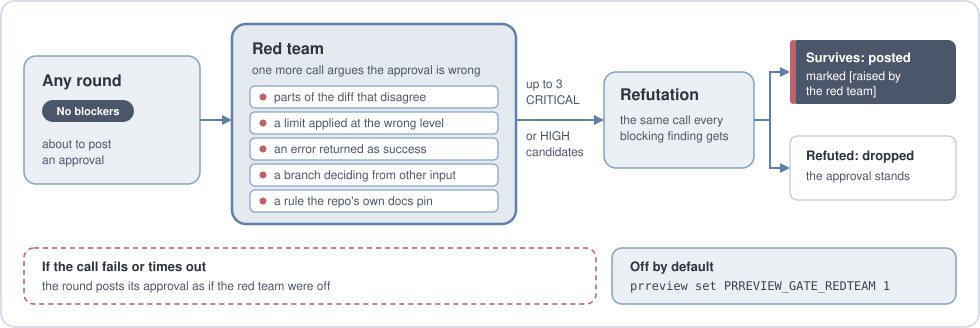

# pr-reviewer

[English](README.md) | 繁體中文

本文件譯自英文版。內容以英文版為準。

[](https://github.com/nagameTW/pr-reviewer/actions/workflows/ci.yml)
[](./LICENSE)
[](#需求)

**pr-reviewer 在使用者自己的機器上審查 pull request。它使用使用者自己的 Claude Code 登入。
它不需要 GitHub Action、App 與 webhook。它不需要 repo 管理權限。**

它監控使用者列出的 repo。它審查每個開啟中 PR 的每個新 head，條件是作者為
[受信任的作者](docs/operations.md#whose-prs-it-reviews)。head 是 PR 最新的提交。對每個新的 head，它請
[Claude Code](https://code.claude.com/docs/en/overview) 以 headless 模式執行一次審查。headless 模式指
不需要畫面的執行方式。

審查工具檢查回傳的內容。接著它貼出一則留言，內含判定與各項發現。

若已設定 [GitHub App](docs/github-app.md)，留言以該 App 發出。否則留言以使用者自己的
`gh` 帳號發出。整個工具是純 bash。它建立在 `gh`、`git`、`jq` 與 `claude` 之上。一個迴圈每分鐘
檢查一次 GitHub。

- **只留言。** 它不送出 GitHub 核准。它不以正式 review 要求修改。它不合併。
- **模型只能讀取。** `--tools` 限制 Claude Code 只能使用 `Read`、`Grep` 與 `Glob`。
  範圍是每個 PR 專屬的 worktree。worktree 是 git 的獨立工作目錄。模型無法使用 shell 與
  網路工具。程式碼不會被執行。
- **規則由預設分支決定。** `CLAUDE.md`、`AGENTS.md` 與其他慣例檔，取自預設分支最新的
  commit。因此 PR 無法放寬自己的審查標準。
- **它會反駁自己提出的阻擋型發現。** 第二次呼叫會嘗試推翻每項阻擋型發現，每輪最多六項。
  這能降低誤報。
- **步驟失敗時不貼文。** 無法解析或無法掃描的回答不會貼出。修復後的回答，判定不會是核准。

<p align="center">
  
</p>

此展示是測試 PR 上的一次真實執行，編號為 Run A。等待時間已剪去。該次執行有三次推送與三輪審查。
第 3 輪核准。

<p align="center">
<picture>
  <source media="(prefers-color-scheme: dark)" srcset="docs/images/overview-dark.svg">
  
</picture>
</p>

## 信任與成本

**信任。** 完整的安全模型見 [SECURITY.md](SECURITY.md)。

- **請在只有使用者本人使用的機器上執行。** 服務以該使用者的身分執行。它使用 `gh` 與
  Claude Code 的登入。若已設定 GitHub App，它也使用該 App 的金鑰。任何能以該使用者身分
  操作的人，都能以該使用者的名義留言。
- **它審查三種 PR：**
  - 來自 repo 本身分支的 PR。
  - 作者登入名稱列在 `PRREVIEW_GATE_TRUSTED_AUTHORS` 的 PR。
  - 以 `prreview once --pr` 指定的 PR。

  其他的 fork PR 一律略過。略過的 PR 上不會留言。
- **PR 文字視為資料。** prompt 中有這項聲明。這是對模型的指示，不能當作沙箱。即使
  模型被誘騙，上述工具限制仍然有效。這些限制需要 Claude Code 2.1.305 或更新版本。
- **審查工具貼出前，會掃描含有 PR 文字或模型輸出的每則留言。** 掃描時比對
  sensitive-patterns 檔。若比對命中，或掃描無法執行，一則簡短的通知取代該留言。通知不引用
  命中的值。
- **模型文字在貼出前會經過跳脫處理。** 在留言的摘要、各項發現與其他清單中，
  下列文字會被插入零寬空格：
  - `@name`。
  - 以 `/command` 或 `bors` 開頭的行。
  - 外觀像發現的行。

  提及不會發出通知。指令不會執行。後續的輪次不會把該行當成發現。限制見
  [SECURITY.md](SECURITY.md)。
- **GitHub App 的 token 只涵蓋一個 repo。** 審查工具只為該 PR 所在的 repo 要求 token。
- **它貼出的是模型寫的內容。** 若 repo 有 bot 依留言指令動作，請改用 GitHub App
  發留言。指令例如 `/lgtm` 或 `bors r+`。該 bot 不可接受此 App 的指令。
- **它使用 Claude Code 登入。**
  - Anthropic 的
    [法律與合規頁面](https://code.claude.com/docs/en/legal-and-compliance)提到 Pro 與 Max
    的公告用量上限。該上限以「ordinary, individual usage」為前提。
    該頁面未給出數字，讀取日期為 2026-10-21。
  - 全天候運作的輪詢工具是否算在內，由 Anthropic 決定。
  - 使用 API key 可避開這個問題。在 shell 中設定的 key 不會傳給背景服務。
    若使用 API key，請在有該 key 的終端機執行 `prreview run`，
    詳見[說明](docs/operations.md#where-to-run-it)。

**成本。**

- 每次推送到 PR，立即開始新的一輪。編輯 PR 的標題、描述或 base 分支，也會開始新的一輪。
  推送到堆疊式 PR 的父分支也一樣。堆疊式 PR 是建立在另一個 PR 分支上的 PR。若 head 未變，
  編輯 PR 與推送到父分支這兩種情況，等到審查工具上一則留言滿 10 分鐘才處理。等待時間由
  `PRREVIEW_GATE_PR_COOLDOWN_MIN` 設定。
- 一輪最多可能發出以下呼叫：
  - 每個切片一次審查呼叫。切片是 diff 切出的一小段，約 250 行。一輪最多 8 個切片。
  - 每個切片第二次審查呼叫。這發生在 1000 行以上 diff 的第一輪，以及免拆分 PR 的第一輪。
    免拆分 PR 的定義見 [docs/operations.md](docs/operations.md#how-one-round-works)。
  - 每項阻擋型發現一次反駁呼叫，最多 6 次。
  - 一次修復呼叫。

  最大的第一輪有 16 次審查呼叫、6 次反駁呼叫與 1 次修復呼叫。尚無測試執行涵蓋這種情況。
  因此費用未知。
- 實測花費：
  - 展示的第 1 輪花費 $0.54。三輪共花費 $1.14，編號 Run A。
  - 第二個測試 PR 花費 $0.75。之後一次未改動內容的推送花費 $0.73，編號 Run B。
  - 在一個小型且無問題的 PR 上，審查花費 $0.34。紅隊另外增加 $0.23，編號 Run C。
    紅隊是選用功能，會對核准提出反駁，說明見〈[審查運作方式](#審查運作方式)〉。
  - 這些執行發生在 2026 年 9 月與 10 月。金額取自 `claude -p` 的回報。使用訂閱方案時，這些金額計入用量上限，不計入帳單。

## 狀態與限制

- **1.0 之前。** 版本之間任何內容都可能改變。升級前請閱讀 [CHANGELOG.md](CHANGELOG.md)。
- **偵測能力未知。** 尚無人統計它找出多少 bug。尚無人統計它產生多少誤報。
- **它只讀程式碼。** 它不執行測試。它不讀取 CI 結果。判定是一則留言，不是 GitHub 的
  review 狀態。核准橫幅的文字是 `Automated review, not a GitHub approval.`。
- **只支援 GitHub，且僅在機器處於喚醒狀態時有效。** PC 睡眠時它暫停。
  - CI 在 Ubuntu 上以系統內建的 bash 執行測試。
  - CI 在 macOS 上以 bash 3.2 的 `/bin/bash` 執行測試。
  - WSL2 不在 CI 內。只有維護者自己的機器確認過，詳見 [docs/windows.md](docs/windows.md)。
  - Bedrock、Vertex 與 gateway 未經測試。
- **一項已知缺口。** 以預設分支為目標的 PR，其 review key 不含 base commit。
  詳見[已知限制](SECURITY.md#known-limits)。
- **三種情況不適合：**
  - 多人共用一個 Claude 登入。
  - 需要能阻擋合併的 required check。
  - 程式碼不得傳給 Anthropic。

[docs/comparison.md](docs/comparison.md) 比較本工具與其他工具的差異。

## 需求

- **macOS 或 Linux。** 在 Windows 上於 WSL2 內執行。
- **bash 3.2 以上。** macOS 內建的 `/bin/bash` 可用。
- **[gh](https://cli.github.com/) 2.63.0 以上**與
  **[Claude Code](https://code.claude.com/docs/en/overview) 2.1.305 以上**。兩者都需已
  登入。`claude update` 會安裝最新版的 Claude Code。
- `git`、`jq`、`curl`、`openssl` 與 `flock`。另需一個 timeout 指令，即 `timeout` 或
  `gtimeout`。另需一個 SHA-256 指令，即 `sha256sum`、`gsha256sum` 或 `shasum`。腳本使用
  最先找到的那一個。
- **Linux 上需 systemd 240 以上**，供背景服務使用。服務以 `StandardOutput=append:`
  寫入日誌。

`prreview setup` 檢查每一項，並印出適合該系統的安裝指令。macOS 搭配 Homebrew 時，
執行 `brew install git jq gh coreutils flock`。Debian 或 Ubuntu 則執行
`sudo apt install git jq curl openssl util-linux coreutils`。接著從
[GitHub 的套件庫](https://github.com/cli/cli/blob/trunk/docs/install_linux.md)安裝 `gh`。

## 快速開始

### 1. 取得程式碼

```bash
git clone https://github.com/nagameTW/pr-reviewer.git ~/pr-reviewer
mkdir -p ~/.local/bin && ln -s ~/pr-reviewer/prreview ~/.local/bin/prreview
```

不要把 clone 放在以下位置：

- `~/Documents`
- `~/Desktop`
- `~/Downloads`
- iCloud Drive，路徑為 `~/Library/Mobile Documents`

macOS 背景服務無法讀取這些位置。若 `~/.local/bin` 不在 `PATH` 中，請把它加入 `PATH`。

### 2. 執行 setup

```bash
prreview setup
```

此指令一次問一個問題。按 Enter 即採用方括號內的值。它處理以下項目：

- 檢查工具，以及 `claude` 與 `gh` 的登入狀態。
- 詢問要審查的 repo。它列出帳號下最多 30 個 repo。其他 repo 請輸入 `owner/repo`。
  請至少列入一個自己擁有的 repo。
- 詢問由誰發留言、使用的模型等項目。

問到 **Background service** 時，回答 `n`。第 4 步才啟動服務。答案寫入
`~/.config/pr-reviewer/config`。

### 3. 審查一個測試 PR

從已列出的 repo 的某個分支開一個小 PR。然後執行：

```bash
prreview once --pr you/repo#12
```

此指令發出真實的模型呼叫，並以 `gh` 帳號貼出留言。結束碼 `0` 表示審查工具對目前的
head 已有判定。結束碼 `75` 表示無判定且無步驟失敗，例如草稿 PR。結束碼 `1` 表示該 PR
已非開啟狀態，或無法讀取。

### 4. 啟動服務

> [!WARNING]
> 注意：在信任本工具之前，只列出自己擁有的 repo。第一輪會審查所列 repo 中，作者受信任
> 且狀態為開啟的每個非草稿 PR。審查工具以 `gh` 帳號在每個 PR 上留言。每次審查都消耗模型用量。

```bash
prreview start
prreview status
prreview logs -f
```

若 `gh` 以 `ssh` 進行 clone，`prreview start` 提議把 `gh` 改為 `https`。原因是 systemd
使用者服務無 ssh-agent，詳見[說明](docs/operations.md#where-to-run-it)。若無待審 PR，
迴圈每檢查 15 次才開始一輪。

在 Linux 上，登出時 systemd 會停止使用者服務。若要持續運作，執行一次 `sudo loginctl enable-linger "$USER"`。

在 WSL2 上，服務需要 `systemd=true`。WSL 關閉時服務停止。詳見 [docs/windows.md](docs/windows.md)。

## 常用指令

| 指令 | 用途 |
| --- | --- |
| `prreview repos add owner/repo`、`prreview repos remove owner/repo` | 變更受審查的 repo |
| `prreview set <name> <value>`、`prreview get <name>`、`prreview unset <name>` | 變更、讀取或重設設定 |
| `prreview once`、`prreview run` | 在此終端機執行一輪，或執行迴圈 |
| `prreview once --pr owner/repo#12` | 立即審查該 PR，fork PR 也包含在內 |
| `prreview stop`、`prreview start`、`prreview restart` | 控制背景服務 |
| `prreview status`、`prreview logs -f` | 顯示狀態與略過的 PR，並持續追蹤日誌 |
| `prreview checks` | 列出、新增或移除審查項目 |
| `prreview uninstall` | 移除背景服務，設定保留 |

變更設定的指令會重新啟動服務。完整移除的方式見
[docs/operations.md](docs/operations.md#removing-it)。

## 升級

```bash
cd ~/pr-reviewer
git pull --ff-only
prreview setup
```

所有問題都按 Enter，即可保留原本的答案。到 Checklist 步驟時，回答 `y` 採用新的內建
項目。按 Enter 則拒絕。

setup 重新啟動服務，因為迴圈在重新啟動前仍執行舊的程式碼。

若 `claude --version` 或 `gh --version` 低於最低版本，setup 會停止。請更新 `claude` 或 `gh`，然後再次執行 setup。

在 0.2.0 之後的版本，審查工具略過 fork PR。作者列在
`PRREVIEW_GATE_TRUSTED_AUTHORS` 中的 PR 除外。`prreview status` 顯示略過的數量。設定
`PRREVIEW_GATE_FORK_PRS=1` 可恢復舊行為。

檢查清單副本中的項目保留舊的措辭。若要檢視新版的變更，執行
`diff -r ~/pr-reviewer/checks ~/.config/pr-reviewer/checks`。

## 審查運作方式

<p align="center">
  
</p>

此留言取自 Run B。留言以判定開頭，每項發現一行。每項發現都指出檔案、行號與修正方式。

審查工具依同一份清單審查每個切片。清單共 13 個項目，每個項目一個檔案，放在 `checks/`
內。「適用時機」欄說明何時採用該項目。每項發現標明所屬項目與嚴重度。

| 項目 | 檢查內容 | 適用時機 |
| --- | --- | --- |
| 1 正確性 | 錯誤、未處理的輸入、被破壞的呼叫端、並行問題 | 一律 |
| 2 安全性 | 注入、授權缺口、密碼學與機密、資料暴露 | 一律 |
| 2b AI agent 安全 | Prompt injection、未經檢查的模型輸出、過度的代理權限 | diff 將內容送給 LLM、賦予 LLM 工具，或依其輸出採取動作 |
| 3 敏感資料 | 真實位址、主機名稱、token 或憑證 | 一律 |
| 4 專案限制 | repo 自己寫下的規則 | 一律 |
| 5 測試 | CI 被削弱、修正 bug 卻無測試、斷言過弱 | 一律 |
| 6 設計 | 過度設計、改動放錯位置 | 一律 |
| 7 文件同步 | 仍在描述舊行為的文件 | 一律 |
| 8 相依套件 | 未宣告，或固定版本的方式與其他套件不一致的相依套件 | 一律 |
| 9 證據優先 | 未經量測便改動的啟發式規則、限制、模型選擇或 prompt | diff 改動其中任一項 |
| 10 工具範圍 | 模型可呼叫、但範圍過廣或無需核准的工具 | diff 定義或變更這類工具 |
| 11 驗收 | diff 未達成關聯 issue 的某項需求 | PR 連結了 issue |
| 12 半套修復 | 相鄰的同類程式碼仍有同樣的缺陷 | 一律 |

審查工具不回報以下項目：

- 阻斷服務，但未設定逾時的呼叫除外。
- 記憶體安全語言中的記憶體安全問題。
- 無可利用路徑的漏洞。
- 由 linter 強制的風格問題。
- 讚美。

CRITICAL 與 HIGH 的發現會阻擋。MEDIUM 與 LOW 的發現只列出，不阻擋。「阻擋」只決定判定的
文字。使用者可以[新增、移除或修改項目](docs/configuration.md#adding-your-own-checks)。
每個項目的完整內容見 [checks/](checks/) 資料夾。

一輪有七個步驟。前四個步驟不呼叫模型。

<p align="center">
<picture>
  <source media="(prefers-color-scheme: dark)" srcset="docs/images/round-dark.svg">
  
</picture>
</p>

每次推送都是新的一輪。prompt 要求模型把先前每項阻擋型發現標為已修正。否則模型加上前綴
`Carried over:` 重複列出該項。執行流程的腳本不檢查模型是否照做。

<p align="center">
<picture>
  <source media="(prefers-color-scheme: dark)" srcset="docs/images/rounds-dark.svg">
  
</picture>
</p>

選用的紅隊會對核准提出反駁。它預設關閉，因為它使每次核准都增加成本與時間。執行 `prreview set PRREVIEW_GATE_REDTEAM 1` 即可開啟。

<p align="center">
<picture>
  <source media="(prefers-color-scheme: dark)" srcset="docs/images/redteam-dark.svg">
  
</picture>
</p>

[docs/operations.md](docs/operations.md) 說明各步驟的細節與步驟失敗時的處理方式。

## 設定

設定由設定檔與覆寫值組成。設定檔是 `~/.config/pr-reviewer/config`，每行一個
`KEY=value`，由 `prreview set` 寫入。環境中設定的變數覆寫設定檔。有兩項設定為必填：
`PRREVIEW_GATE_REPOS` 與 `PRREVIEW_SENSITIVE_PATTERNS_FILE`。後者指向 `prreview setup`
寫出的 sensitive-patterns 檔。最常修改的設定如下：

- `PRREVIEW_GATE_TRUSTED_AUTHORS`
- `PRREVIEW_GATE_FORK_PRS`
- `PRREVIEW_REVIEW_MODEL`
- `PRREVIEW_GATE_PARALLEL`
- `PRREVIEW_GATE_PR_COOLDOWN_MIN`
- `PRREVIEW_GATE_REDTEAM`
- `PRREVIEW_GATE_TICKETS`
- `PRREVIEW_ALERT_REPO`

延伸閱讀：

- [docs/configuration.md](docs/configuration.md) 列出每項設定及其預設值。
- [docs/operations.md](docs/operations.md) 說明單一輪的細節與失敗處理。
- [docs/github-app.md](docs/github-app.md) 說明以 App 身分留言的方式。
- [docs/windows.md](docs/windows.md) 說明 WSL2。

## 開發

```bash
bash tests/run-all.sh
```

該指令執行 `bash -n`、`shellcheck -S warning` 與每一個 `tests/*.test.sh`。它不需要
網路、`gh` 或模型。未安裝 `shellcheck` 時該指令失敗。請在 `git clone` 的目錄內執行。
檢查使用 `git ls-files` 列出腳本。ZIP 下載的內容在這一步失敗。

CI 在 Ubuntu 與 macOS 上執行相同的指令。請見 [CONTRIBUTING.md](CONTRIBUTING.md)。本專案把可預測的審查行為，置於
審查範圍的廣度之前。

## 授權

[MIT](LICENSE)
