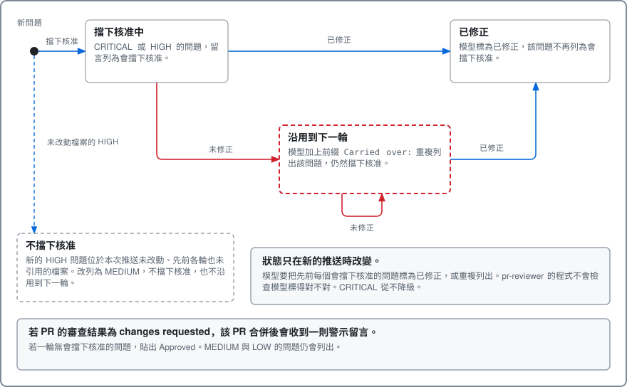
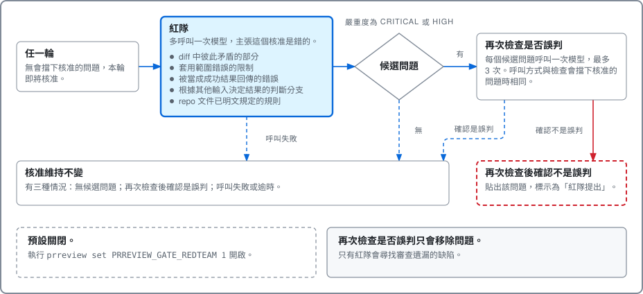

# 圖表

本頁收錄 pr-reviewer 的四張圖。每張圖預設收合，選取標題即可展開。圖會依瀏覽器的淺色或深色主題切換。英文版圖表見 [Diagrams](../how-it-reviews.md#diagrams)。

## 整體架構

說明各部分如何在使用者的機器上合作。

架構：使用者的機器、GitHub 與 Claude Code

<picture>
  <source media="(prefers-color-scheme: dark)" srcset="../images/overview-zh-dark.svg">
  
</picture>

## 一輪審查

一輪有七個步驟，前四個步驟不呼叫模型。

一輪審查的七個步驟

<picture>
  <source media="(prefers-color-scheme: dark)" srcset="../images/round-zh-dark.svg">
  
</picture>

## 同一個問題在多輪之間的狀態

每次推送都開始新的一輪。prompt 要求模型對先前每個會擋下核准的問題二擇一：標為已修正，或加上前綴 `Carried over:` 重複列出，沿用到下一輪。pr-reviewer 的程式不會檢查模型是否照做。

同一個問題在多輪之間的狀態

<picture>
  <source media="(prefers-color-scheme: dark)" srcset="../images/rounds-zh-dark.svg">
  
</picture>

## 紅隊

紅隊是選用功能。pr-reviewer 準備核准時，紅隊多呼叫一次模型，請他主張這個核准是錯的。預設關閉，因為每次核准都會增加成本與時間。執行 `prreview set PRREVIEW_GATE_REDTEAM 1` 即可開啟。

選用的紅隊：核准之前多一道檢查

<picture>
  <source media="(prefers-color-scheme: dark)" srcset="../images/redteam-zh-dark.svg">
  
</picture>

